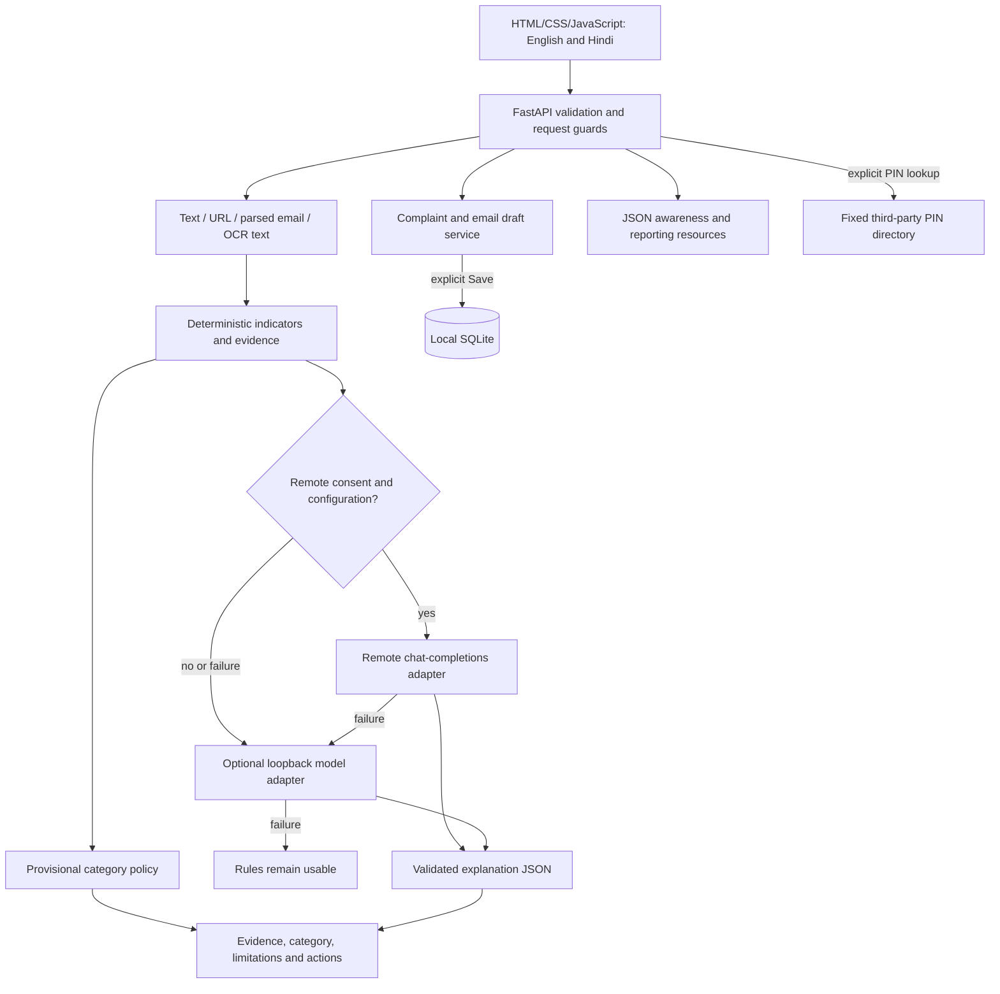

# DIGI SURAKSHA — Technical design

Version: submission MVP, 31 October 2026. This document describes implemented behavior and distinguishes optional integrations from verified capabilities.

## 1. Scope and architecture

A local-first modular monolith combines suspicious-content assessment, bilingual awareness and complaint preparation. It runs without an account, model download or paid API. It does not submit government complaints, send email, authenticate an email sender, certify a URL safe or guarantee fund recovery.

Risk is calculated from deterministic evidence before optional interpretation. The AI output cannot alter the category or deterministic indicator list.

## 2. Modules and boundaries

| Path | Responsibility |
| --- | --- |
| `app/main.py` | ASGI app, security headers, body limits, primary routes, OCR and static UI |
| `app/schemas.py` | Pydantic validation for analysis, model output and incident intake |
| `app/resources_api.py` | Banks, locations, stats, attachments and advisory-review endpoints |
| `app/services/detection.py` | Input routing, email extraction, text/URL indicators, risk and bilingual guidance |
| `app/services/ai.py` | Provider protocol, compatible HTTP adapter, timeout/fallback and schema validation |
| `app/services/incidents.py` | Drafts, history, retention, saved attachments and anonymous counts |
| `app/services/uploads.py` | File byte/count/signature validation and safe filename handling |
| `app/services/advisories.py` | Bundled content and local pending/review/publish lifecycle |
| `app/services/locations.py` | Six-digit PIN lookup against one fixed HTTPS origin |
| `app/web/` | Responsive UI, client orchestration, English/Hindi locale files |
| `data/*.json` | Configurable resources, awareness content and evaluation results |

The frontend uses browser locale preference persistence, escaped user text and same-origin API calls. Uploaded community advisories retain their original language; no automatic translation is claimed.

## 3. Detection flow and category policy

1. Validate JSON fields or bounded upload; identify text, URL, email or screenshot.
2. Parse email text/selected headers or extract screenshot text using Tesseract. Original screenshot analysis is in memory and not saved as an incident automatically.
3. Match documented patterns and URL structures; retain short supporting evidence excerpts. No submitted destination is fetched or DNS-resolved.
4. Apply the fixed risk policy: Critical = arrest/safe-account indicator plus urgency or credential request; High = credential request, coercion, or at least three distinct indicator IDs; Moderate = any other matched indicator; Low = no configured indicator.
5. Optionally explain matched findings through configured AI, preserving language-independent JSON keys.
6. Return provisional assessment, evidence, limitations, potential impact, immediate actions and a reporting-route identifier.

No numeric probability, calibrated score or confidence percentage is provided. Missing email authentication results alone are not evidence of fraud. Pasted SPF/DKIM/DMARC results are reported header content, not cryptographic verification. The current rules have known contextual and multilingual misses and false positives.

## 4. Optional AI integration

A shared `Provider` protocol is implemented by an OpenAI-compatible chat-completions HTTP adapter, parameterised for REMOTE and LOCAL configuration. Remote is tried only with explicit user consent. Otherwise, or on remote failure, local is attempted when configured; all failures degrade to useful rules. Each HTTP operation has an 8-second timeout, disabled redirects and ignored environment proxies. The local endpoint hostname must be loopback.

Only matched finding snippets are sent, not the full original input, but snippets can contain personal information. Pydantic validates `summary` and `evidence_ids`; unknown evidence IDs are rejected. Evidence is marked untrusted in the system instruction and the model has no tools. These controls do not prove model prose is truthful, injection-proof or correctly translated. No actual model endpoint was configured for submission validation; orchestration is covered with controlled tests. GGUF weights and llama.cpp are not bundled.

## 5. API surface

Interactive schema: `/docs`; machine-readable schema: `/openapi.json`.

| Method and route | Purpose |
| --- | --- |
| `GET /api/health` | App, Tesseract availability and provider-configuration flags |
| `POST /api/analyze` | Validated JSON analysis |
| `POST /api/analyze/upload` | Multipart PNG/JPG/WEBP or EML analysis |
| `GET /api/reporting`, `/api/banks`, `/api/advisories` | Configured public resources |
| `GET /api/locations/states`, `/api/locations/{pin}` | State list and opt-in external PIN lookup |
| `POST /api/incidents` | JSON incident draft generation and optional save |
| `POST /api/incidents/prepare` | Multipart incident payload and optional evidence |
| `GET /api/incidents`, `DELETE /api/incidents/{id}` | Local history and deletion |
| `GET` / `DELETE /api/incidents/{id}/attachments/{attachment_id}` | Saved evidence download/deletion |
| `GET /api/stats` | Today (IST) and cumulative local saved-incident counts |
| `POST /api/advisories/upload` | Submit content and optional file for local review |
| `GET /api/advisories/review` | Local review queue |
| `POST /api/advisories/{id}/publish` | Publish after explicit review confirmation |
| `GET /api/advisories/{id}/attachment`, `DELETE /api/advisories/{id}` | Advisory download/removal |

Core analysis response fields: `input_type`, `risk`, `assessment`, `indicators`, `metadata`, `confidence`, `potential_impact`, `actions`, `reporting_route`, `ai`, `provider`, `extracted_text`. Stable API identifiers remain English in Hindi responses.

## 6. Persistence and retention

`data/incidents.sqlite3` is created at runtime and excluded from Git. Tables are initialised with `CREATE TABLE IF NOT EXISTS` and a small migration marker:

- `incidents(id, created, payload)` — UUID, UTC creation time and incident/draft JSON.
- `attachments(id, incident_id, name, media_type, content)` — SQLite evidence blobs; foreign-key cascade on incident deletion.
- `incident_counts(day, count)` — aggregate saved records by IST date, not verified crimes or official complaints.
- `advisory_submissions(id, created, status, payload, name, media_type, content)` — pending/published local submissions.
- `migrations(name)` — one-time counter initialisation.

Incident content is persisted only with Save. Regenerating an existing saved ID updates it without incrementing counts; a new saved ID counts once. Incident content and attachments expire after 30 days and are purged on the next database connection, not by a scheduled job. Anonymous aggregates remain. Advisories remain until removed. Deletion does not guarantee secure disk/back-up erasure. Edited draft text is copied/exported from the browser but is not automatically persisted as edited text.

## 7. Security and privacy boundaries

- Default binding is `127.0.0.1:8000`; host/write-origin checks restrict browser access.
- Request body cap: 6 MB. Analysis files: 5 MB; images: 12 million pixels. Incident attachments: at most three and 5 MB combined. Advisory file: 5 MB.
- Filename sanitisation, signature/format checks, parameterised SQL, forced attachment downloads, CSP, no-store and no-referrer headers are implemented. No uploaded code is executed.
- PDF signature checks are not full PDF validation or malware scanning. There is no antivirus, public-user authentication, rate limiter or encryption at rest.
- Local review endpoints are operator controls without a separate administrator identity. Anyone able to use the local app can access saved data and review controls.
- Submitted suspicious URLs and advisory source URLs are not fetched. PIN lookup contacts a fixed external provider with only the PIN, and manual entry remains available. Official links and video links open in the user's browser. Swagger uses CDN assets.
- Evidence bodies and secrets are not deliberately logged; provider errors are not exposed to users. The repository contains no runtime databases, secrets, model weights or real victim submissions.

These safeguards support a local demonstration; they do not establish production readiness. Public hosting requires access control, encrypted storage, abuse controls and independent security/privacy review.

## 8. Verification, sample data and future work

Run `python -m pytest -q` and `python -m scripts.evaluate`. Tests isolate databases and exercise detection, actual OCR where installed, uploads, retention, consent/fallback, evidence-ID validation, incident fields, attachments, counts, review and mocked PIN lookup. See `TEST_RESULTS.md` for measured results and limitations, and `data/examples/README.md` for safe demonstration inputs.

The 16-case development evaluation records TP 6 / TN 5 / FP 3 / FN 2, precision 0.667 and recall 0.750 at Moderate-or-higher as a warning. This tiny synthetic set is not a representative benchmark. Next work: larger held-out multilingual evaluation, context/negation handling, Hindi OCR verification, live model testing, verified TXT download behavior and shared-deployment hardening.
